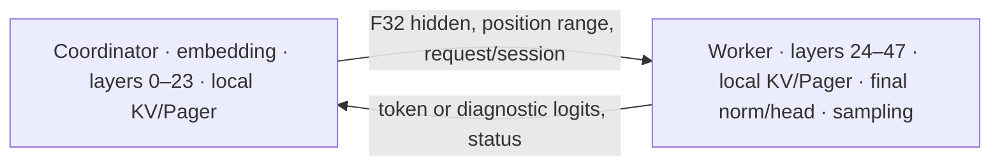
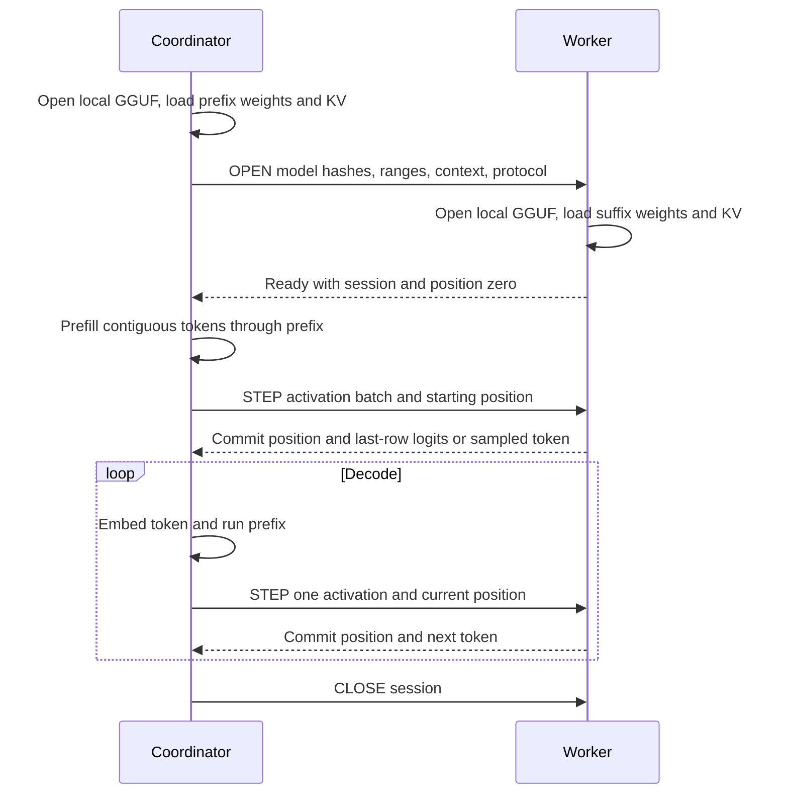

# Phase 2A architecture

Choose a dedicated local-stage Worker. Keep the existing Qwen3MoE operations and Pager in each process, and place the network boundary after layer 23 residual/cvec. Model layer indices stay global.

In `llama_model_qwen3moe::graph::graph`, `build_inp_embd`, `build_inp_pos`, `build_attn_inp_kv` and `build_inp_out_ids` provide the graph inputs. Each layer reads its own QKV/norm/RoPE parameters and local KV and runs MoE before the residual and `build_cvec`. Prefix exports every output row, including during prefill. Final-stage output selection stays at the last model layer, followed by final norm and projection. Worker reconstructs positions and causal mask from the same ordered token range and single sequence, with the same RoPE options and Context size. Inference begins with fixed token IDs and explicit outputs for correctness, before enabling greedy sampling on the Worker.

Each model loads metadata locally, then creates only its own tensors. Each local external tensor owns a provider reference via its local Tensor extra field. The model registers local source ID, shard offset, stride and expert count. The CPU kernel requests an Expert ID, the local model-owned Pager pins a slot and reads the local GGUF if needed, and workers hold the lease through compute. Release follows the kernel barrier. Free context/graph before the model releases the provider, cache and files. No provider handles cross the boundary.

| Candidate | Changes and tradeoffs |
|---|---|
| A. Extend GGML RPC | Reuses device dispatch and ordinary tensors. Requires coordinated loader, scheduler, wire metadata, server Pager ownership and error propagation changes for external experts. Existing remote allocations can host weights/KV but default upload path can read and transfer all ordinary weights from Coordinator. |
| B. Dedicated layer Worker | Changes range-aware load, graph entry/exit and KV filtering. Reuses local CPU/Pager and shares graph math. One bounded stage exchange per block, clear session failure handling, composable stage ranges for more hosts. |
| C. Remote Expert compute | Stages attention/KV on Coordinator and assigns remote expert weights. Requires dispatch, route aggregation and numerical ordering at every layer. Potential load balancing gains need per-layer scheduling and additional failure handling. |

Use initially fixed regions, x86-64, identical revision and full GGUF/shard hashes. Use fixed-width little-endian wire scalars and contiguous F32 boundary data. Decode into locally aligned storage with explicit GGML shape/stride. Validate same-host bitwise and report tolerances between CPU builds. The Worker validates framing, shape, length, range, version, step/position and model identity. Loopback first. For LAN restrict peer addresses and interfaces with host firewall and an isolated trusted subnet. Existing RPC lacks an authenticated encrypted session in this experiment.
